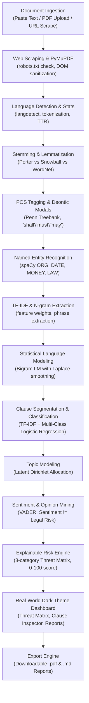

# AI-Based Terms and Conditions Analyzer Using NLP

[](https://ai-terms-analyzer.vercel.app)
[](https://python.org)
[](https://react.dev)
[](https://tailwindcss.com)
[](LICENSE)

> **Author:** Manish  
> **PRN:** 124B1C122  
> **Discipline:** B.Tech Computer Science & Engineering (Artificial Intelligence & Machine Learning)  
> **Project Edition:** Real-World Enhanced Edition  

---

## 1. Project Overview

**AI-Based Terms and Conditions Analyzer** is a full-stack legal intelligence web application engineered to parse, dissect, and evaluate Terms of Service agreements, Privacy Policies, and End-User License Agreements (EULAs). 

Standard legal agreements often span tens of thousands of words filled with dense, deceptive legalese designed to obscure predatory terms. This application utilizes an end-to-end Natural Language Processing (NLP) pipeline and machine learning models to:
- Detect predatory, unfair, and high-risk legal clauses.
- Present an interactive **Consumer Threat Matrix: At a Glance**.
- Calculate an explainable **Overall Risk Rating (0–100)** with categorical severity levels.
- Perform multi-class legal clause classification across 8+ contractual domains.
- Extract deontic legal modalities (*"shall"*, *"must"*, *"may"*), named entities, and latent topics.
- Generate downloadable executive reports in both **Markdown (`.md`)** and **PDF** formats.

> **LEGAL NOTICE & DISCLAIMER:** This software is an automated NLP intelligence tool designed for informational and educational assistance only. It does not constitute formal legal advice or substitute for consultation with a licensed legal attorney.

---

## 2. System Architecture & NLP Pipeline



---

## 3. Real-World Dashboard Features

The dashboard layout features a dark-themed consumer protection interface:

### 1. Left Control Sidebar
- **Flexible Document Ingestion:**
  - 🟠 **Paste Text:** Ingest raw contractual text with live character count (up to 30,000 characters).
  - 🌐 **Fetch from Web URL:** Ethical scraper with built-in `robots.txt` parsing and DOM boilerplate stripping.
  - 📄 **Upload PDF Document:** In-memory PDF text extraction powered by PyMuPDF (`fitz`).
- **Load Pre-Configured Samples:** 1-click loading for *Streaming Entertainment (High Risk - 78/100)* and *E-Commerce Store (Fair - 14/100)*.
- **100% Local & Private Card:** Highlights on-device privacy guarantee without sending user contracts to third-party APIs.
- **SQLite Audit History:** View, reload, and review past contract analyses stored in the local SQLite database.

### 2. Consumer Threat Matrix: At a Glance
A responsive grid of categorical threat cards with real-time **Red 🔴 (Danger)** and **Green 🟢 (Safe)** status indicators:
- 👁️ **Data & Privacy:** Discloses user data monetization, commercialization, and broker sharing.
- 💳 **Auto-Renewal:** Flags automatic billing recurring charges and silent subscription rollovers.
- ⚖️ **Dispute & Court Rights:** Detects mandatory binding arbitration tribunals and constitutional class-action waivers.
- 📝 **Content Rights & IP:** Flags perpetual, irrevocable, worldwide licenses claimed over user submissions.
- 🚫 **Refund Policy:** Identifies strict no-refund policies and prepaid balance forfeiture.
- ⚠️ **Account Termination:** Flags unilateral account termination without cause, notice, or data recovery.
- 📍 **Location & Surveillance:** Highlights continuous background GPS tracking and device fingerprinting.
- 🔄 **Unilateral Changes:** Flags clauses allowing vendors to secretly modify terms without prior notice.
- **`› Show matched clause`:** Interactive drawer expanding each card to reveal the exact quoted legal sentence from the contract.

### 3. Overall Risk Rating & Reports
- **Risk Score Display:** Prominent `XX / 100` score with severity pill (`↑ X risky clauses flagged`).
- **Download Analysis Report (.md):** Generates a formatted Markdown audit report.
- **Download Analysis Report (.pdf):** Generates a formal PDF audit report using ReportLab.
- **Copy Executive Summary:** 1-click clipboard copy for quick sharing.

### 4. Interactive Analytical Sub-Tabs
- **📄 Clause Risk Report:** Searchable, filterable list of all extracted clauses with severity toggles (`ALL`, `High`, `Medium`, `Low`), category dropdowns, and deep-dive inspection drawers.
- **🔍 Key Details & POS:** Deontic modal verbs table (`shall`, `must`, `may`), named entities extracted by spaCy, and detected governing legal jurisdictions.
- **📊 NLP Insights:** Dedicated interactive sandboxes for testing all 10 modular NLP components with custom inputs.
- **📜 History & Reports:** Review and manage past contract audits persisted in SQLite.

---

## 4. Core NLP & Machine Learning Engine

The system is built on 10 reusable, decoupled NLP engineering modules:

| Module | File | Core Engineering Function |
|---|---|---|
| **Web Scraping & Ingestion** | `a1_web_scraping.py` | Validates `robots.txt` via `urllib.robotparser`, removes non-content tags (`nav`, `script`, `style`), parses multi-page PDFs via PyMuPDF (`fitz`), and handles HTTP error codes. |
| **Language Stats & Tokenization** | `a2_language_stats.py` | Identifies language via `langdetect`. Computes word count, sentence count, char count, average sentence length, and Type-Token Ratio (TTR / lexical diversity). |
| **Morphological Reduction** | `a3_stem_lemmatize.py` | Comparative analysis between NLTK `PorterStemmer`, `SnowballStemmer`, and `WordNetLemmatizer` (with POS context mapping), showing why dictionary lemmatization prevents legal ambiguity. |
| **POS Tagging & Classification** | `a4_pos_embeddings_clf.py` | Dual POS tagging with deontic modal analysis (*"shall"*, *"must"*, *"may"*). Dense vector space similarity retrieval using cosine similarity. Multi-class legal clause classifier trained using TF-IDF and Logistic Regression. |
| **Named Entity Recognition (NER)** | `a5_ner.py` | Extracts entities (`ORG`, `DATE`, `MONEY`, `PERCENT`, `GPE`, `LAW`, `PRODUCT`) via spaCy with an academic analysis on the limitations of general-purpose NER models on legal agreements. |
| **TF-IDF Feature Weights** | `a6_tfidf.py` | Implements scikit-learn `TfidfVectorizer` to calculate term frequency-inverse document frequency scores, isolating discriminative contractual commitments from boilerplate text. |
| **N-gram Phrase Models** | `a7_ngrams.py` | Unigram, bigram, and trigram frequency extraction to capture multi-word legal constructions (*"personal information"*, *"automatic renewal"*, *"class action waiver"*). |
| **N-gram Language Modeling** | `a8_language_model.py` | Bigram statistical language model with Laplace ($k=1.0$) and Add-$k$ smoothing. Calculates sequence log-probabilities and sequence Perplexity. |
| **Topic Modeling (LDA)** | `a9_topic_modelling.py` | Latent Dirichlet Allocation (scikit-learn `LatentDirichletAllocation`) discovering recurring thematic clusters (*Data Privacy*, *Billing*, *Liability*, *Dispute Resolution*). |
| **Sentiment & Opinion Mining** | `a10_sentiment_opinion.py` | NLTK VADER sentiment scoring and subjective assertion mining (*"sole discretion"*), demonstrating why negative sentiment does not equate to legal risk. |

---

## 5. Risk Scoring Methodology

Contracts are evaluated from **0 to 100** across 10 weighted dimensions:

1. **Mandatory Arbitration & Class Action Waiver** (+25 pts) — Strips rights to court trials or collective litigation.
2. **Third-Party Data Commercialization** (+22 pts) — Selling/sharing user data to advertising brokers (with negation checks like *"do not sell"*).
3. **Unilateral Terms Modifications** (+20 pts) — Modifying terms at any time without advance notice.
4. **Persistent Geolocation Tracking** (+18 pts) — Continuous background location tracking when the app is closed.
5. **Immediate Termination Without Cause or Notice** (+18 pts) — Sudden account closure and data deletion without recourse.
6. **Perpetual IP Content License** (+18 pts) — Demanding irrevocable, transferable commercial rights over user content.
7. **Severe Limitation of Liability Cap** (+16 pts) — Restricting recovery to an insignificant cap (e.g., $50).
8. **Automatic Renewal & No Refunds** (+14 pts) — Silent recurring charges with zero refunds for outages.
9. **Indefinite Data Retention** (+12 pts) — Keeping personal records indefinitely even after account deletion.
10. **Broad Indemnification Burden** (+10 pts) — Forcing the user to pay company legal defense costs.

### Risk Ratings:
- **Low Risk (0 – 34):** Standard, fair contract with minimal rights forfeiture.
- **Medium Risk (35 – 64):** Caution advised; contains auto-renewals or unilateral modification clauses.
- **High Risk (65 – 100):** Predatory terms detected; forced arbitration, persistent surveillance, or liability waivers.

---

## 6. Technology Stack

- **Frontend:** React 19, Tailwind CSS v4, Lucide React icons, Chart.js, react-chartjs-2, Vite.
- **Backend:** Python 3.13, Flask, Flask-CORS.
- **NLP & Machine Learning:** NLTK, spaCy (`en_core_web_sm`), scikit-learn (`TfidfVectorizer`, `LogisticRegression`, `LatentDirichletAllocation`), langdetect.
- **Document Processing:** PyMuPDF (`fitz`) for PDF extraction, BeautifulSoup4 for HTML scraping.
- **Report Generation:** ReportLab (automated PDF report creation).
- **Database:** SQLite (persisting past analyses, summaries, and full reports).
- **Testing:** pytest (12 automated unit tests across all pipeline modules).

---

## 7. How to Run Locally

### Prerequisites
- Python 3.10+ (Tested on Python 3.13)
- Node.js 18+ and npm

### 1-Click Launch (Windows)
Double-click:
```cmd
.\run_all.bat
```
This automatically boots:
- **Backend API:** `http://127.0.0.1:5000`
- **React Frontend:** `http://localhost:3000`

### Manual Launch
**Terminal 1 (Backend):**
```cmd
python backend\app.py
```
**Terminal 2 (Frontend):**
```cmd
cd frontend
npm run dev
```

---

## 8. Automated Unit Testing

Run pytest across all pipeline modules and the risk engine:
```cmd
python -m pytest backend\tests -v
```
**Result:** 12 passed in ~7 seconds.

---

## 9. License

This project is licensed under the MIT License — see the LICENSE file for details.
