# AI-Based Terms and Conditions Analyzer Using Natural Language Processing (NLP)

An end-to-end, enterprise-grade full-stack legal intelligence application that analyzes Terms and Conditions, Privacy Policies, and contractual legal agreements using Natural Language Processing. It identifies predatory, unfair, or concerning clauses, assigns explainable risk levels (Low, Medium, High), performs multi-class clause categorization, discovers latent themes, detects unilateral assertions, visualizes findings on a **real-world commercial dashboard**, and produces downloadable PDF audit reports and opt-out legal notices.

> **LEGAL NOTICE & DISCLAIMER:** This software is an educational NLP tool designed for informational and research assistance only. It does NOT provide professional legal advice nor does it establish an attorney-client relationship.

---

## 1. System Architecture & Real-World Dashboard Pipeline

```mermaid
flowchart TD
    A["Document Ingestion\n(Paste Text / PDF Upload / URL Scrape)"] --> B["Assignment 1: Ingestion & Scraping\n(BeautifulSoup, robots.txt, PyMuPDF)"]
    B --> C["Assignment 2: Language & Statistics\n(langdetect, tokenization, TTR)"]
    C --> D["Assignment 3: Stemming & Lemmatization\n(Porter vs Snowball vs WordNet)"]
    D --> E["Assignment 4: POS Tagging & Deontic Modals\n(Penn Treebank, 'shall'/'must'/'may')"]
    E --> F["Assignment 5: Named Entity Recognition\n(spaCy ORG, DATE, MONEY, LAW)"]
    F --> G["Assignment 6: TF-IDF & Assignment 7: N-grams\n(feature weights, phrase extraction)"]
    G --> H["Assignment 8: Statistical Language Model\n(Bigram LM with Laplace smoothing)"]
    H --> I["Clause Segmentation & Assignment 4: Classifier\n(TF-IDF + Multi-Class Logistic Regression)"]
    I --> J["Assignment 9: Topic Modelling\n(Latent Dirichlet Allocation)"]
    J --> K["Assignment 10: Sentiment & Opinion Mining\n(VADER, Sentiment != Legal Risk)"]
    K --> L["Explainable Risk Engine\n(10 categories, rule weights, 0-100 score)"]
    L --> M["Real-World Enterprise Dashboard\n(Trust Grade, Regulatory Audit, Fair Clauses, Opt-Out Tool)"]
    M --> N["Export Suite\n(ReportLab PDF, SQLite History, JSON)"]
```



---

## 2. Real-World Commercial Dashboard Sections

The dashboard is engineered with sections modeled after enterprise contract compliance and privacy intelligence software (e.g., OneTrust, Robin AI, Termly, Ironclad):

1. **Executive Header & Quick Action Suite**:
   - Provider / Document Title, Ingestion channel badge, Language, Audit processing speed in seconds.
   - Quick Action buttons: Download Audit PDF, Generate Arbitration Opt-Out Notice, Export Raw JSON, Print Summary.
2. **Executive Scorecard (4 Key Metrics)**:
   - **Consumer Trust Grade:** Letter grade from **A+ to F** alongside a 0–100% Trust Index and certification verdict.
   - **Overall Risk Meter:** 0–100 Risk Score with Red Flag and Moderate Risk clause counters.
   - **Readability & Complexity Index:** Flesch Reading Ease score and Educational Grade Level (e.g., *"College Graduate / Attorney Level"*).
   - **Contractual Balance Ratio:** Visual dual-progress bar contrasting **Corporate Shield Bias** vs **Consumer Rights Protection**.
3. **Regulatory & Statutory Compliance Audit Matrix**:
   - Benchmarks the contract against 5 major global consumer and privacy legal frameworks:
     - **GDPR (EU 2016/679):** Data Minimization & Right to Erasure (Art. 17).
     - **CCPA / CPRA (Cal. Civ. Code § 1798.120):** Mandatory "Do Not Sell/Share" compliance.
     - **FTC Act Section 5 & Click-to-Cancel Rule:** Deceptive negative-option billing and cancellation barriers.
     - **UCC § 2-316 & § 2-719:** Conspicuousness of warranty disclaimers and unconscionable damage caps.
     - **Federal Arbitration Act (FAA):** Enforceability of pre-dispute arbitration & class action waivers.
4. **Executive TL;DR: "What You Forfeit" vs "What You Retain"**:
   - High-contrast, two-column breakdown showing exactly which constitutional and consumer rights are surrendered vs which affirmative protections are provided.
5. **10-Dimension Risk Heatmap & Matrix**:
   - Interactive progress tiles for all 10 legal governance areas (Arbitration, Location Tracking, Data Sharing, Unilateral Changes, Auto-Renewal, Liability, Termination, Data Retention, IP Rights, Indemnity).
   - Shows severity status (*Safe*, *Moderate*, *Critical Risk*) with one-click clause isolation.
6. **AI Contract Redaction: "Predatory Clause vs Fair Alternative"**:
   - Side-by-side comparison showing the company's one-sided clause alongside an AI-suggested **Fair Market Alternative Clause** with plain-English legal rationale.
7. **Action Center: 30-Day Arbitration & DSAR Opt-Out Generator**:
   - Interactive tool pre-filling a formal written Opt-Out Notice and Data Subject Access Request (DSAR) with user name, email, and address for one-click copy or `.txt` download.
8. **Interactive Visual Charts (Chart.js)**:
   - Doughnut Chart: Risk Severity distribution (High, Medium, Low).
   - Horizontal Bar Chart: Categorical clause distribution across legal domains.
9. **Top Priority Red Flags Warning Cards**:
   - Critical clauses with one-click rationale inspection modals.
10. **Clause Explorer with Multi-Filters & Instant Search**:
    - Search by keyword, filter by Risk Level, Category, and Sentiment polarity.

---

## 3. Integration of All 10 NLP Assignments

Every assignment is built as a separate reusable Python module under `backend/modules/` and connected into the central pipeline (`backend/pipeline.py`), with dedicated interactive sandboxes in the React UI:

| # | NLP Assignment | Module | Core Implementation & Pedagogical Principle |
|---|---|---|---|
| **1** | **Web Scraping & Document Ingestion** | `a1_web_scraping.py` | Uses `requests` and `BeautifulSoup`. Validates `robots.txt` via `urllib.robotparser`. Extracts readable text, strips boilerplate headers/navbars, handles HTTP errors (403/404/timeouts), extracts PDFs via PyMuPDF (`fitz`), and ingests plain text. |
| **2** | **Language Detection, Statistics & Tokenization** | `a2_language_stats.py` | Detects document language via `langdetect`. Computes word count, sentence count, char count, average sentence length, and Type-Token Ratio (TTR / lexical diversity). Includes sample records and demonstration of the **HuffPost News Category Dataset (2012–2018)** with an explicit disclaimer distinguishing news prose from legal policy contracts. |
| **3** | **Stemming & Lemmatization** | `a3_stem_lemmatize.py` | Comparative analysis between NLTK `PorterStemmer`, `SnowballStemmer`, and `WordNetLemmatizer` (with POS context mapping). Demonstrates how stemmers produce non-words (*"arbitr"*, *"liabil"*) while lemmatizers retain true dictionary roots (*"liability"*). |
| **4** | **POS Tagging, Embeddings & Clause Classification** | `a4_pos_embeddings_clf.py` | Part-of-Speech tagging with deontic modality analysis (*"shall"*, *"must"*, *"may"*). Dense vector space similarity retrieval using cosine similarity. Supervised multi-class legal clause classifier trained using TF-IDF and Logistic Regression across 8+ contractual categories. |
| **5** | **Named Entity Recognition (NER)** | `a5_ner.py` | Extracts entities (`ORG`, `DATE`, `MONEY`, `PERCENT`, `GPE`, `LAW`, `PRODUCT`) via spaCy. Contains an in-depth academic report detailing the **limitations of general-purpose NER on legal contracts** (e.g. OntoNotes domain mismatch, defined legal party roles vs proper nouns, statutory citations, and all-caps distortion). |
| **6** | **TF-IDF Feature Weights** | `a6_tfidf.py` | Implements scikit-learn `TfidfVectorizer` to calculate term frequency-inverse document frequency weights, isolating discriminative contractual terms while penalizing ubiquitous functional noise. |
| **7** | **N-gram Models** | `a7_ngrams.py` | Generates unigram, bigram, and trigram distributions to detect recurring contractual constructions (*"personal information"*, *"third-party services"*, *"automatic renewal"*, *"class action waiver"*, *"sole discretion"*). |
| **8** | **N-gram Language Model** | `a8_language_model.py` | Bigram statistical language model with Laplace ($k=1.0$) and Add-$k$ smoothing. Calculates step-by-step transition probabilities, joint sequence log-probabilities, and sequence Perplexity. Highlights that statistical likelihood $\neq$ legal risk. |
| **9** | **Topic Modelling (LDA)** | `a9_topic_modelling.py` | Latent Dirichlet Allocation (scikit-learn `LatentDirichletAllocation`) discovering recurring themes (*Data Privacy*, *Billing & Subscription*, *Liability Disclaimers*, *Dispute Resolution*, *Termination*). Explains that unsupervised Dirichlet distributions require human legal domain interpretation. |
| **10** | **Sentiment, Emotion & Opinion Mining** | `a10_sentiment_opinion.py` | NLTK VADER sentiment analysis and subjective opinion mining (*"sole discretion"*). Features an interactive demonstration of the **Sentiment $\neq$ Legal Risk Paradox** (e.g., *"We do not sell personal data"* is negative sentiment but Low Risk; *"We are delighted to share your location logs with partners"* is positive sentiment but High Risk). |

---

## 4. Risk Analysis Engine & Scoring Methodology

The engine scores agreements from **0 to 100** across 10 critical consumer rights dimensions:

1. **Mandatory Arbitration & Class Action Waiver** (+25 pts) — Strips rights to jury trials or collective litigation.
2. **Unilateral Terms Modifications** (+20 pts) — Vendor modifies terms at any time without advance notice.
3. **Third-Party Data Commercialization** (+22 pts) — Selling or leasing user data to brokers (with negative-lookahead to ignore *"do not sell"*).
4. **Persistent Geolocation Tracking** (+18 pts) — Continuous background location tracking when app is closed.
5. **Termination Without Notice or Cause** (+18 pts) — Immediate account closure and data deletion without recourse.
6. **Perpetual IP Content License** (+18 pts) — Royalty-free, transferable worldwide license over user uploads.
7. **Severe Limitation of Liability Cap** (+16 pts) — Restricting company damages to $50 or past month's fee.
8. **Automatic Renewal & No Refunds** (+14 pts) — Silent recurring charges with zero refunds for outages.
9. **Indefinite Data Retention** (+12 pts) — Storing personal records perpetually even after account deletion.
10. **Broad Indemnification Burden** (+10 pts) — Forcing user to pay company legal defense costs.

### Trust Letter Grades:
- **Grade A+ / A (0 – 25 pts):** Trust Index 75–100%. Consumer protective, standard terms.
- **Grade B / C (26 – 64 pts):** Trust Index 36–74%. Moderate risk; standard commercial auto-renewals or disclaimers.
- **Grade D / F (65 – 100 pts):** Trust Index 0–35%. Predatory terms; forced arbitration, persistent surveillance, or liability waivers.

---

## 5. Technology Stack

- **Frontend:** React 19, Tailwind CSS v4, Lucide React icons, Chart.js, react-chartjs-2, Vite.
- **Backend:** Python 3.13, Flask, Flask-CORS.
- **NLP & Machine Learning:** NLTK, spaCy (`en_core_web_sm`), scikit-learn (`TfidfVectorizer`, `LogisticRegression`, `LatentDirichletAllocation`), langdetect.
- **Document Processing:** PyMuPDF (`fitz`) for PDF extraction, BeautifulSoup4 for HTML web scraping.
- **Report Generation:** ReportLab (automated PDF report creation with Trust Grades and Compliance tables).
- **Database:** SQLite (persisting past analyses, summaries, and full reports).
- **Testing:** pytest (12 automated unit tests across all assignments).

---

## 6. How to Run the Project

### Prerequisites
- Python 3.10+ (Installed: Python 3.13)
- Node.js 18+ (Installed: Node v24.14, npm 11.11)

### Quick Start (One-Click)
Run the automated launcher batch script:
```powershell
.\run_all.bat
```
This automatically boots:
- **Backend API:** `http://127.0.0.1:5000`
- **React Frontend:** `http://localhost:3000`

### Manual Start (Alternative)
In Terminal 1 (Backend):
```powershell
python backend\app.py
```
In Terminal 2 (Frontend):
```powershell
cd frontend
npm run dev
```

---

## 7. Running Unit Tests

Run pytest across all 10 assignment modules, the pipeline, and the risk engine:
```powershell
python -m pytest backend\tests -v
```
**Output:**
```text
============================= test session starts =============================
platform win32 -- Python 3.13.15, pytest-9.1.1, pluggy-1.7.0
collected 12 items

backend\tests\test_assignments.py ............                           [100%]

============================= 12 passed in 6.34s ==============================
```

---

## 8. College Viva & Examination Q&A Guide

### Q1: Why can we not rely purely on sentiment analysis for legal risk detection?
**Answer:** In Assignment 10, we demonstrate that contractual language is drafted in neutral, sanitized legal terminology. A predatory clause like *"We may share all user records and GPS coordinates with marketing partners"* has positive sentiment words (*"share"*, *"partners"*) but is severe risk. Conversely, a consumer-protective clause like *"We do not sell, rent, or lease your personal data"* contains negative negation words (*"not"*, *"sell"*) but is Low Risk. Legal risk must be evaluated through domain classification and substantive risk triggers.

### Q2: What is the purpose of Laplace smoothing in Assignment 8's Language Model?
**Answer:** In an n-gram language model, if a word transition $w_{i-1} \to w_i$ never appeared in the training corpus, its maximum likelihood estimate is $0$, which causes the entire sequence probability product $\prod P(w_i | w_{i-1})$ to collapse to $0$ and results in infinite Perplexity. Laplace smoothing adds $+1$ (or $+k$) to the numerator and $k \times |V|$ to the denominator, guaranteeing non-zero probability for unseen pairs while preserving mathematical probability axioms.

### Q3: Why does general-purpose NER (Assignment 5) struggle with legal contracts?
**Answer:** Standard NER models like `en_core_web_sm` are trained on OntoNotes 5.0 (newswire). In contracts:
1. Actors are defined by legal roles (*"Data Controller"*, *"Indemnitee"*, *"Sub-processor"*) rather than named companies.
2. Complex statutory citations (*"15 U.S.C. § 1681"*) get misclassified as cardinal numbers or dates.
3. UCC conspicuousness requirements force warranty disclaimers to be written in ALL-CAPS, distorting capitalization features.

### Q4: Why is lemmatization preferred over stemming in legal NLP (Assignment 3)?
**Answer:** Stemming applies heuristic suffix chopping rules (e.g., converting *"liabilities"* into the non-word stem *"liabil"*). Lemmatization uses morphological vocabularies and part-of-speech context to return the true canonical dictionary root (*"liability"*). In legal contexts, preserving exact statutory root words prevents semantic ambiguity.
